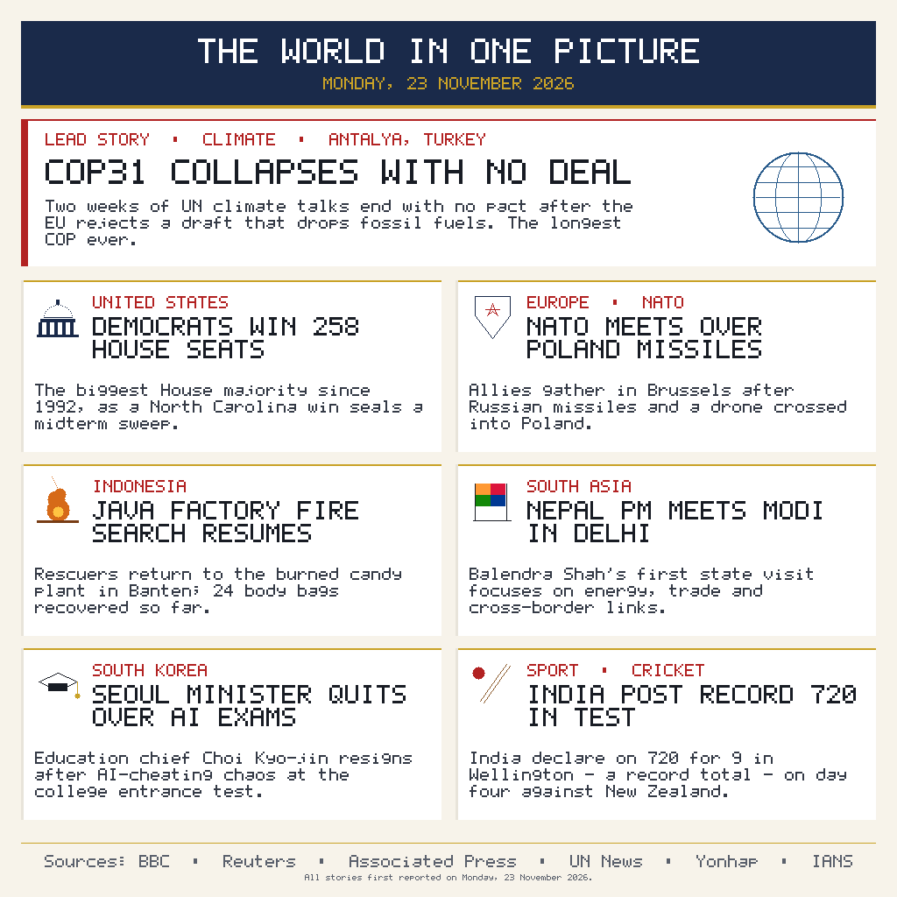

# The world in one picture: Monday, 23 November 2026

[](https://make.fun/bounty/news-image-20261123?utm_source=github&utm_medium=readme&utm_campaign=news-image-20261123)
[](https://make.fun/bounty/news-image-20261123/leaderboard?utm_source=github&utm_medium=readme&utm_campaign=news-image-20261123)
[](https://make.fun/bounty/news-image-20261123?utm_source=github&utm_medium=readme&utm_campaign=news-image-20261123)

A newspaper-style picture of the world's news of **Monday, 23 November 2026** — one image that sums up the day in seven stories, drawn entirely in code (pure Node 22 stdlib, no network, no external fonts).



## The seven stories

1. **COP31 collapses with no deal** — Two weeks of UN climate talks in Antalya end with no pact after the EU rejects a final draft that drops any mention of fossil fuels; the longest COP ever. *(BBC, UN News, Reuters, CNN)*
2. **Democrats win 258 House seats** — The biggest US House majority since 1992, as a North Carolina win seals a midterm sweep. *(Associated Press, Reuters, Fox News)*
3. **NATO meets over Poland missiles** — Allies gather in Brussels after Russian missiles and a drone crossed into Polish airspace. *(Anadolu Agency, Polish Radio, RMF24)*
4. **Java factory fire search resumes** — Rescuers return to the burned candy plant in Banten, Indonesia; 24 body bags recovered so far. *(BBC, Reuters, Associated Press)*
5. **Nepal PM meets Modi in Delhi** — Balendra Shah's first state visit focuses on energy, trade and cross-border links. *(IANS, ANI, India's Ministry of External Affairs)*
6. **Seoul minister quits over AI exams** — Education chief Choi Kyo-jin resigns after AI-cheating chaos at South Korea's college entrance test. *(Korea JoongAng Daily, Yonhap, The Guardian)*
7. **India post a record 720 for 9** — On day four of the Wellington Test against New Zealand, India declare on a record total. *(Associated Press, Reuters)*

## How it is built

`render.mjs` draws `entry.png` (1024×1024, PNG) with a hand-written 5×7 bitmap font and a pure-Node PNG encoder (raw RGB + `node:zlib`, CRC32 by hand). `main.ts` then copies `entry.png` to the output directory, byte for byte — deterministic, so both grader runs write identical files.

```sh
node render.mjs   # redraw entry.png
mkdir -p out && MAKEFUN_OUTPUT_DIR=out node main.ts
```

## Entry

- Competition: [news-image-20261123 on make.fun](https://make.fun/bounty/news-image-20261123)
- Program: `main.ts` (Node 22, stdlib only) → writes `/output/entry.png`
- License: MIT

---

Built for the make.fun bounty — if you enter too, use referral code **515temp1**: https://make.fun/r/515temp1
